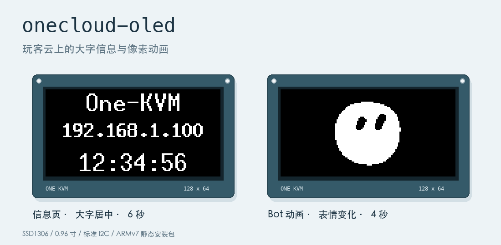
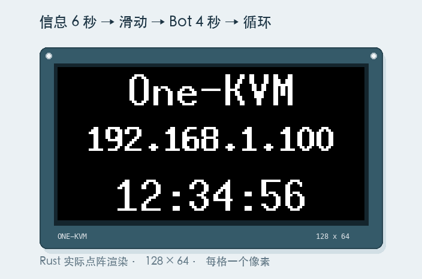

<div align="center">

# onecloud-oled

**给玩客云添一块清晰、会动的 OLED 小屏幕。**

[](https://github.com/kiliter/onecloud-oled/actions/workflows/build-release.yml)
[](https://github.com/kiliter/onecloud-oled/releases/latest)


[下载安装包](https://github.com/kiliter/onecloud-oled/releases/latest) · [效果预览](#效果预览) · [快速安装](#快速安装) · [接线与运行](#接线与运行)



</div>

用 Rust 驱动 **0.96 寸 SSD1306 / 128×64 OLED**，轮流显示大字设备信息与 Grok Bot 风格的黑白点阵动画。提供 ARMv7 静态安装包，玩客云上无需安装 Rust、Cargo 或 Python。

## 效果预览

<p align="center">
  
</p>

以上为 **Rust 实际绘制函数导出的模拟效果**。每一格对应一个 OLED 像素，实际动画流畅度以设备的 GPIO / I2C 传输速度为准。

| 画面 | 内容 | 显示方式 |
| --- | --- | --- |
| 信息页 | `One-KVM`、当前 IPv4、本地时间 `HH:MM:SS` | 大字分层、三行居中，停留 **6 秒** |
| Bot 动画页 | 眨眼、左右看、呼吸、弹动与表情变化 | 单色点阵，停留 **4 秒** |
| 页面切换 | 信息页与动画页循环播放 | **450 毫秒**向左滑动转场 |
| 字体 | 标题 / 时间 `10×20`，IP `8×13` 粗体 | 最长 15 字符 IPv4 可完整显示 |

信息每 **2 秒**更新。网络未就绪时显示 `--` 并持续重试；初始化或刷新失败时退出，由 systemd 每隔 **5 秒**重启。

## 快速安装

当前正式版：[**v1.0.0**](https://github.com/kiliter/onecloud-oled/releases/tag/v1.0.0)。适用于玩客云 ARMv7 Linux，默认 GPIO 参数为 **SDA 17 / SCL 11**。

先退出前台运行的旧程序，再在玩客云上以 **root** 下载并校验：

```bash
cd /opt
curl -fLO https://github.com/kiliter/onecloud-oled/releases/download/v1.0.0/onecloud-oled-armv7-v1.0.0.tar.gz
curl -fLO https://github.com/kiliter/onecloud-oled/releases/download/v1.0.0/onecloud-oled-armv7-v1.0.0.tar.gz.sha256
sha256sum -c onecloud-oled-armv7-v1.0.0.tar.gz.sha256
```

校验显示 `OK` 后安装：

```bash
tar -xzf onecloud-oled-armv7-v1.0.0.tar.gz
cd onecloud-oled-armv7-v1.0.0
sh install.sh
```

安装脚本会核对包内文件、停止旧服务、更新程序与 GPIO 配置、重启服务，并启用开机自启。服务使用 `Restart=always`。

[完整安装说明](deploy/INSTALL.md)包含从电脑上传、手动安装、查看日志和时区设置。

## 接线与运行

| 项目 | 默认配置 |
| --- | --- |
| 显示模块 | SSD1306、0.96 寸、128×64 |
| 通信地址 | I2C `0x3C` |
| GPIO 芯片 | `/dev/gpiochip0` |
| SDA | **line 17** |
| SCL | **line 11** |
| 软件 I2C | 开漏输出，配置频率 **50000 Hz**，保持原有上拉 |

上述 GPIO 参数已在本次玩客云接线上点亮屏幕。其他接线通过命令行指定对应的 **GPIO line 编号**。

前台试运行：

```bash
systemctl stop onecloud-oled.service
./onecloud-oled --gpio /dev/gpiochip0 17 11
```

按 `Ctrl+C` 退出，再执行 `systemctl restart onecloud-oled.service` 恢复服务。

不带参数时，程序依次初始化 `/dev/i2c-0`、`/dev/i2c-1`，选择第一个成功的总线；两者均失败则非零退出。所有显示通信均使用标准 I2C 并检查 ACK。

<details>
<summary><b>更多参数与诊断命令</b></summary>

| 参数 | 用途 |
| --- | --- |
| `--address 0x3C` | 地址可选择 `0x3C` 或 `0x3D` |
| `--frequency 50000` | 软件 I2C 配置频率，范围 `1000`～`100000` Hz |
| `--pull-up` | 启用内部上拉 |
| `--version` / `--help` | 查看版本或用法 |

```bash
# 只读查询，不申请引脚。
./onecloud-oled --gpio-info /dev/gpiochip0

# 停止服务后，诊断指定两条引脚的电平与 ACK。
systemctl stop onecloud-oled.service
./onecloud-oled --gpio-probe /dev/gpiochip0 17 11

# 查看服务状态与日志。
systemctl status onecloud-oled.service --no-pager
journalctl -u onecloud-oled.service -n 30 --no-pager
```

诊断模式会操作指定 GPIO 的电平和上拉配置。

</details>

## 构建与发布

在装有 Docker 的电脑上构建：

```bash
git clone https://github.com/kiliter/onecloud-oled.git
cd onecloud-oled
sh scripts/build-armv7.sh
```

输出为 `dist/onecloud-oled-armv7-v1.0.0.tar.gz` 及对应 `.sha256` 文件。脚本使用 Rust 1.90、`Cargo.lock` 和 `rust-lld`，依赖缓存位于 `target/cargo-home`。

[GitHub Actions](https://github.com/kiliter/onecloud-oled/actions/workflows/build-release.yml)自动完成：

1. 检查格式、Clippy 和单元测试。
2. 交叉编译 ARMv7 musl 静态二进制，生成安装包与 SHA-256 校验文件。
3. 检查归档，并在 QEMU 中执行 ARMv7 程序，验证版本和错误退出。
4. 推送与 Cargo 版本匹配的 `v*` 标签时，发布 [GitHub Release](https://github.com/kiliter/onecloud-oled/releases)。

推送 `main`、提交 Pull Request 或手动触发同样会构建，并保存可下载的 Actions 产物。

## 实现与开发预览

使用 `ssd1306`、`embedded-graphics`、`linux-embedded-hal` 和 `local-ip-address`。动画帧在编译时生成并嵌入程序；运行时差分绘制，以单调时间推进，传输变慢时跳过过期帧。目标帧率为 **12 fps**。

| 文件 | 职责 |
| --- | --- |
| [src/main.rs](src/main.rs) | 启动、总线选择、信息刷新与播放循环 |
| [src/bus.rs](src/bus.rs) | 硬件 / GPIO I2C 与诊断 |
| [src/ui.rs](src/ui.rs) | 大字布局、差分画布与滑动转场 |
| [build.rs](build.rs) | 预生成 Bot 点阵帧 |
| [deploy/](deploy/) | systemd 服务配置与安装脚本 |
| [preview/oled-preview.html](preview/oled-preview.html) | 离线交互预览与字号比较 |

下载并用浏览器打开 HTML，可比较字号、调整预览的表情、转场和停留时间；这些选项用于视觉对比，不会修改设备设置。

<details>
<summary><b>本机测试与重新生成 README 效果图</b></summary>

准备 Rust 工具链后运行：

```bash
cargo test --locked
cargo run --locked --example render-preview -- target/readme-frames --animation
```

在电脑上安装 Pillow，再将 Rust 导出的点阵帧排版为图片和动图：

```bash
python3 -m pip install Pillow
python3 scripts/render-readme.py
```

渲染脚本支持 macOS 的系统中文字体或 Linux 的 Noto Sans CJK。也可通过 `ONECLOUD_OLED_FONT` 指定中文字体文件。输出位于 `docs/images/`，Pillow 仅用于电脑上生成文档配图。

</details>

测试覆盖轮播边界、长时间播放、像素擦除、转场首尾、最长 IPv4 居中及动画帧范围。GitHub 编译、归档校验和模拟执行与实机验收分别验证；设备上的实际动画流畅度、服务持续运行及开机启动仍需实机确认。
