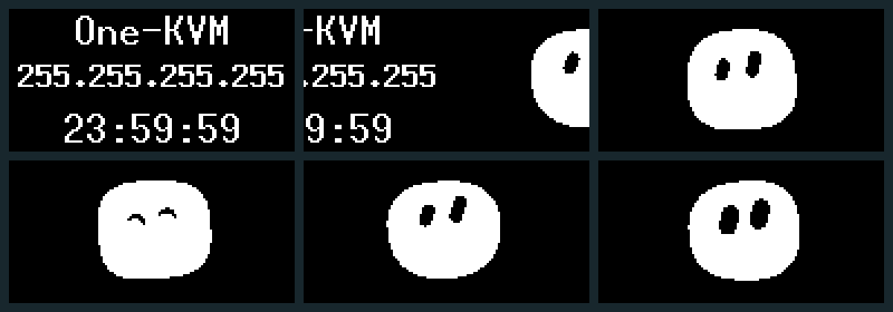

# 玩客云 OLED 两页轮播

[](https://github.com/kiliter/onecloud-oled/actions/workflows/build-release.yml)

Rust 程序，适用于 SSD1306、128×64、I2C 地址 0x3C。使用 ssd1306、embedded-graphics、linux-embedded-hal 和 local-ip-address。

## 显示效果

- 信息页停留 6 秒：One-KVM、当前 IPv4、本地时间 HH:MM:SS，三行居中。
- 标题和时间使用 FONT_10X20，IP 使用 FONT_8X13_BOLD，最长 IPv4 可完整显示。
- 450 毫秒向左滑动，切换到 Grok Bot 风格点阵动画，停留 4 秒后滑回信息页。
- Bot 有眨眼、左右看、呼吸、弹动和表情变化；信息每 2 秒重新获取。

v1.0.0 已将确认的 HTML 默认效果实现到 Rust，并移除 Python 复刻模式。全部通信使用标准 I2C，检查 ACK；初始化、清屏或刷新失败时非零退出，供 systemd 重启。网络未就绪时显示 --，每 2 秒重试；连续获取 IP 失败仅在开始失败时记录一次日志。

动画在编译时生成 144 个单色帧并嵌入二进制，运行时不计算逐像素浮点几何。使用单调时间推进轮播，传输较慢时跳过过期帧，不积累播放延迟。仅提交发生变化的像素，由 SSD1306 驱动刷新脏区域；目标帧率 12 fps，实际帧率和转场流畅度取决于 GPIO/I2C 传输速度。

## 总线与接线

用户已在这台玩客云上确认 SDA line 17 / SCL line 11 可以点亮屏幕，新包沿用此参数：

```bash
./onecloud-oled --gpio /dev/gpiochip0 17 11
```

GPIO 模式使用开漏输出，默认软件 I2C 频率 50000 Hz，保持原有上拉配置。可选参数：--address 0x3C 或 0x3D、--frequency 1000 至 100000、--pull-up。

不带参数启动时，依次初始化 /dev/i2c-0、/dev/i2c-1，选择第一个成功的总线；两者均失败则退出。附带的 GPIO 服务配置适用于本次已确认的接线。

```bash
# 只读查询，不申请引脚。
./onecloud-oled --gpio-info /dev/gpiochip0

# 诊断指定两条引脚，会操作电平和上拉；先停止服务。
systemctl stop onecloud-oled.service
./onecloud-oled --gpio-probe /dev/gpiochip0 17 11

./onecloud-oled --version
./onecloud-oled --help
```

## ARMv7 安装包

产物：[onecloud-oled-armv7-v1.0.0.tar.gz](https://github.com/kiliter/onecloud-oled/releases/download/v1.0.0/onecloud-oled-armv7-v1.0.0.tar.gz)。设备无需安装 Rust、Cargo、Python 或编译器。包内包含静态二进制、systemd 服务、17/11 GPIO 配置、安装脚本、说明、HTML 预览和 SHA-256 校验清单。

完整复制与安装命令见 [安装说明](deploy/INSTALL.md)。上传安装包到设备 /opt 后，以 root 执行：

```bash
cd /opt
tar -xzf onecloud-oled-armv7-v1.0.0.tar.gz
cd onecloud-oled-armv7-v1.0.0
sh install.sh
```

安装脚本先核对校验清单，再停止旧服务、更新二进制和 gpio.conf、启用开机自启并重启。服务使用 Restart=always、RestartSec=5。

## 编译

在有 Docker 的电脑上构建 ARMv7 musl 静态安装包：

```bash
sh scripts/build-armv7.sh
```

脚本使用 Rust 1.90 镜像、Cargo.lock 和 rust-lld；依赖缓存放在 target/cargo-home，不修改电脑的 Rust 工具链。

若直接在 Linux 设备上编译，先准备 Rust 工具链，然后执行：

```bash
cargo build --release --locked
sudo systemctl stop onecloud-oled.service
sudo install -m 0755 target/release/onecloud-oled /usr/local/bin/onecloud-oled
sudo install -m 0644 onecloud-oled.service /etc/systemd/system/onecloud-oled.service
sudo mkdir -p /etc/systemd/system/onecloud-oled.service.d
sudo install -m 0644 deploy/onecloud-oled-gpio.conf /etc/systemd/system/onecloud-oled.service.d/gpio.conf
sudo systemctl daemon-reload
sudo systemctl enable onecloud-oled.service
sudo systemctl restart onecloud-oled.service
```

## 预览与验证

[离线 HTML](preview/oled-preview.html) 可对比字号、设置停留时间、选择表情和转场。Rust 实现采用默认大字居中、6/4 秒和滑动转场；HTML 中的其他选项不会修改设备设置。

`cargo test --locked` 验证轮播时间边界和长时间播放、差分绘制及像素擦除、滑动首尾、最长 IPv4 居中、动画变化和范围。可用以下命令导出 Rust 实际绘制的 PBM 点阵帧：

```bash
cargo run --locked --example render-preview -- target/preview
```

新版本的实机动画流畅度、systemd 持续运行和开机自启仍需在设备上验收；之前实机确认的是标准 GPIO 17/11 模式能够点亮屏幕。

## GitHub Actions 与发布

推送 main、提交 Pull Request 或手动触发会检查格式、Clippy 和测试，生成 ARMv7 静态安装包并保存为 Actions 产物。推送 v* 标签时，还会核对标签与 Cargo.toml 版本，校验归档，在 QEMU 中执行 ARMv7 程序，再通过 GitHub Release 发布安装包及归档 SHA-256 文件。

首次正式版本为 [v1.0.0](https://github.com/kiliter/onecloud-oled/releases/tag/v1.0.0)。后续发布时，同步更新 Cargo.toml、Cargo.lock、文档版本及发布说明，提交后推送匹配的标签。发布说明模板位于 .github/RELEASE_NOTES.md。


